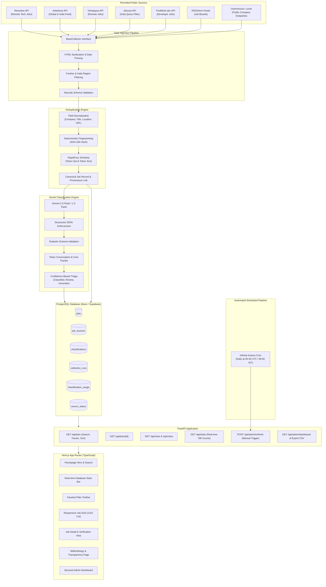

# LaunchBoard System Architecture

## 1. Executive Summary

**LaunchBoard** is an AI-powered job and internship discovery platform specifically engineered for Indian freshers and college graduates. The platform addresses fragmented hiring across the country by aggregating authentic entry-level openings from permitted, publicly accessible APIs, official career pages, and RSS feeds. It applies intelligent deterministic and fuzzy deduplication, normalizes disparate schemas, classifies role categories and extracted cities using LLMs, and presents real-time verified opportunities through a responsive Next.js web application.



---

## 2. Ingestion & Collector Architecture

All collectors inherit from `BaseCollector` (`app/collectors/base.py`) providing a unified contract:

```python
class BaseCollector(abc.ABC):
    name: str
    base_url: str
    rate_limit_delay: float

    @abc.abstractmethod
    async def collect(self) -> list[RawJob]:
        ...
```

### 2.1 Permitted Public Sources
1. **Remotive API** (`app/collectors/remotive_collector.py`):
   - Access: Authorized public REST API (`https://remotive.com/api/remote-jobs`).
   - Filters: Software development, QA, DevOps, design, data categories with remote access open to India.
2. **Arbeitnow API** (`app/collectors/arbeitnow_collector.py`):
   - Access: Authorized public JSON job feed (`https://www.arbeitnow.com/api/job-board-api`).
   - Filters: India location matching and remote allowances.
3. **Himalayas API** (`app/collectors/himalayas_collector.py`):
   - Access: Public remote listings feed (`https://himalayas.app/jobs/api`).
4. **Adzuna India API** (`app/collectors/adzuna_collector.py`):
   - Access: Authorized developer tier API with `ADZUNA_APP_ID` and `ADZUNA_APP_KEY`.
   - Queries: Targeted search for `"fresher intern junior"`, `"graduate trainee"`, `"entry level developer"` across Indian locations.
5. **FindWork.dev API** (`app/collectors/findwork_collector.py`):
   - Access: Developer API using token authorization.
6. **Public Company ATS Feeds** (`app/collectors/greenhouse_collector.py`, `lever_collector.py`):
   - Access: Public JSON board endpoints published by tech startups (e.g., Razorpay, Swiggy, CRED, Hasura, Postman).
7. **RSS/Atom Feed Aggregator** (`app/collectors/rss_collector.py`):
   - Robust heuristic parser using `feedparser` with regex patterns (`Company: Title`, `Title at Company`, etc.).

### 2.2 Ingestion Guarantees
- **No Scraping of Forbidden Sites**: Operates strictly within terms of service and robots.txt.
- **Fail-Safe Graceful Degradation**: If an individual collector fails, errors are captured in `source_status` without halting other collectors.
- **Authentic Provenance**: Every job record retains its original `application_url` and `source_name`. URLs are never synthesized or fabricated.

---

## 3. Deduplication Engine

The deduplication engine (`app/services/deduplication.py`) employs a multi-tier matching strategy to preserve one canonical record while tracking multi-source appearances:

### Stage 1: Deterministic Fingerprinting
- **Company Normalization**: Strips corporate legal designations (`Pvt Ltd`, `Private Limited`, `Inc`, `LLC`, `Technologies`, `Software`, `India`) using word-boundary regular expressions and removes punctuation.
- **Title Normalization**: Removes trailing location markers (`- Bengaluru`, `- Remote`, `(India)`).
- **Location Normalization**: Maps colloquial variants to canonical Indian cities (`Bangalore` -> `Bengaluru`, `Bombay` -> `Mumbai`, `Gurgaon` -> `Gurugram`, `NCR` -> `Delhi`).
- **Fingerprint Computation**:
  $$\text{fingerprint} = \text{SHA256}(\text{norm\_company} \parallel \text{"|"} \parallel \text{norm\_title} \parallel \text{"|"} \parallel \text{norm\_location})$$

### Stage 2: Canonical Application URL Matching
- Normalizes protocols (`http` / `https`), removes `www.`, strips trailing slashes, and purges tracking query parameters (`utm_source`, `ref`, `campaign`).
- Identifies cross-posted jobs pointing to the identical destination.

### Stage 3: RapidFuzz Similarity Check
- Calculates token sort and token set ratios:
  $$\text{Score} = \max(\text{token\_sort\_ratio}(T_1, T_2), \text{token\_set\_ratio}(T_1, T_2)) \ge 85.0$$
- Evaluates both title and normalized company to prevent false positives across disparate roles.

---

## 4. GenAI Classification & Cost Tracking

### 4.1 Supported Role Categories
1. Software Development
2. Frontend Development
3. Backend Development
4. Full Stack Development
5. AI/ML Engineering
6. Data Science
7. Data Analytics
8. DevOps / Cloud
9. Cybersecurity
10. Mobile Development
11. QA / Testing
12. UI/UX Design
13. Product Management
14. Business Development
15. Other

### 4.2 Experience Level Classification
The model explicitly classifies jobs into one of 5 discrete tiers:
- **Fresher**: Explicitly 0 years or college graduates.
- **Internship**: Time-bound learning/training engagements (2–6 months).
- **Entry-level**: 0–2 years experience.
- **Experienced**: 2+ years required.
- **Unknown**: Insufficient signal.

### 4.3 Confidence Thresholding
- **$\ge 0.85$ (High)**: Status marked as `classified`. Directly visible in primary filters.
- **$0.65 - 0.84$ (Medium)**: Status marked as `review`.
- **$< 0.65$ (Low)**: Status marked as `uncertain`. Preserved in database, not silently dropped.

### 4.4 Model Economics & Cost Measurement
Every request tracks prompt tokens and candidate tokens.
- **Gemini 2.0 Flash Pricing** (as of February 2025):
  - Input: \$0.10 / 1,000,000 tokens
  - Output: \$0.40 / 1,000,000 tokens
- **Projected Cost per 1,000 Listings**:
  $$\text{Cost per 1,000} = \left(\frac{\text{Total Actual USD}}{\text{Processed Posts}}\right) \times 1,000 \approx \$0.09 - \$0.12$$

---

## 5. Database Schema & Normalization

Designed with PostgreSQL and SQLAlchemy 2.0 with Alembic migrations:

| Table | Primary Key | Key Foreign Keys | Purpose |
|-------|------------|------------------|---------|
| `jobs` | UUID | None | Canonical job listings with indexed title, company, role, city, and dedup fingerprint |
| `job_sources` | UUID | `job_id -> jobs.id` (CASCADE) | Provenance tracking for every source where a listing was seen |
| `classifications` | UUID | `job_id -> jobs.id` (CASCADE) | Complete audit log of AI evaluations, tokens, and raw JSON response |
| `collection_runs` | UUID | None | Execution telemetry (fetched, new, updated, duplicates, failed, errors) |
| `classification_usage`| UUID | `collection_run_id -> collection_runs.id` | Cumulative token count and computed USD expenditures per run |
| `source_status` | UUID | None | Collector health, circuit-breaker metrics, and consecutive failure counts |

---

## 6. Frontend Design Philosophy

- **Tech Stack**: Next.js 14 App Router, TypeScript, Tailwind CSS, shadcn/ui components, Lucide icons, `next-themes`.
- **Aesthetic**: Premium minimalist editorial SaaS. Clean high-contrast typography, subtle borders, responsive layouts (mobile, tablet, desktop).
- **No Artificial Metrics**: Stats bar fetches live SQL counts (`/api/stats`). Skeletons display during fetches. Empty states feature clear reset actions.
- **Data Authenticity**: Every job card clearly displays the data source, verified timestamp, and an external direct "Apply Now" button opening the canonical employer URL.
